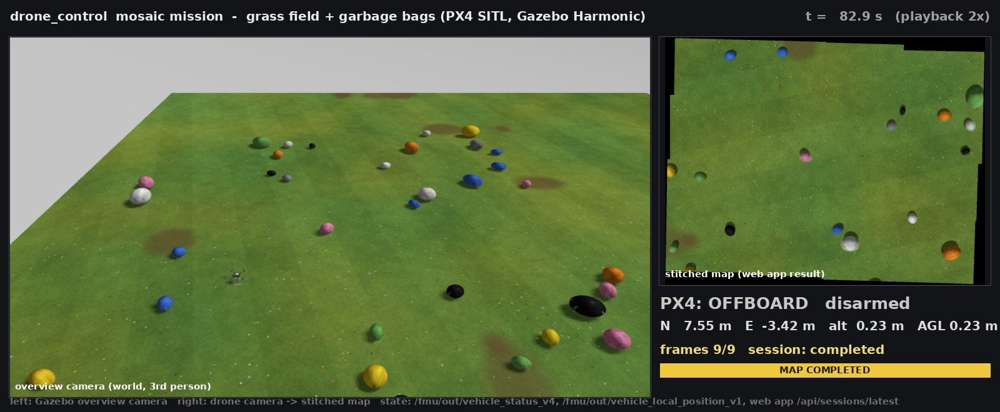

# drone_control

PX4 offboard waypoint navigation and a minimal **survey-and-mark** mission for
ROS 2 Humble + PX4 SITL (Gazebo Harmonic, x500).

One node, `waypoint_navigator`, does both jobs:

* **Waypoint mission** - fly a YAML list of waypoints, then hover or land.
* **Survey mission** - fly to one target, hover, take a photo with a downward
  camera, then hold position while drawing three laser beams and the
  equilateral triangle they would project on the ground as RViz markers.
* **Mosaic mission** - fly to the reported point, photograph a 3x3 grid around
  it (nine frames, each streamed to the ground station the moment it is
  taken) and stitch them into one map with the inherited `drone-stitching`
  project. See *Mosaic mission* below.

---

> **Going from simulation to the real X500 V2 / Pixhawk 6C / Raspberry Pi 5 /
> Arducam B0353?** Read [docs/HARDWARE_BRINGUP_GUIDE.md](docs/HARDWARE_BRINGUP_GUIDE.md) -
> wiring, PX4 and Pi setup, camera, Wi-Fi ROS 2, bench tests and the first
> flights, step by step. The mission geometry (20 x 10 m mosaic, 6.25 m AGL with
> the B0353) is in *Real camera and the 20 x 10 m mosaic* below.

## Coordinate conventions

PX4 works in a **local NED** frame, which is the single most common source of
sign errors, so this package is explicit about it:

| Axis | Direction | Notes |
|------|-----------|-------|
| `x`  | **North** (metres) | positive = north of the origin |
| `y`  | **East** (metres)  | positive = east of the origin |
| `z`  | **Down** (metres)  | **negative = above the origin** |

The origin is the EKF local origin: in SITL, the spot where the vehicle sat when
the estimator initialised - i.e. the takeoff pad.

### Altitude is positive-up in the YAML file and in `target_altitude`

Writing `z: -5.0` for "5 metres up" is easy to get wrong, so the YAML file takes
a **positive `altitude`** (and the survey mission a positive `target_altitude`)
and the node flips the sign exactly once:

```
z_ned = -altitude
```

For YAML input that is `_parse_waypoint()`, for the survey target it is
`_read_parameters()`, both in
[`drone_control/waypoint_navigator.py`](drone_control/waypoint_navigator.py).
`altitude: 5.0` becomes `position[2] = -5.0` in the `TrajectorySetpoint`.

A `z:` key is accepted as an alias in the YAML, but **it is still read as a
positive-up altitude**, not as a raw NED `z`. Prefer `altitude:`.

### Yaw

Degrees by default (`yaw_in_degrees:=false` for radians), NED convention:
North `0`, East `90`, South `180`, West `-90` (or `270`, wrapped). Converted to
radians and wrapped into `[-pi, pi]` for PX4.

### RViz is ENU

Markers and the `map -> base_link` transform are published in ENU
(x = East, y = North, z = Up), the ROS convention:
`(E, N, U) = (y_ned, x_ned, -z_ned)`. See `laser_triangle.ned_to_enu()`.

---

## PX4 topic names

Verified against the **live bridge** with `ros2 topic list | grep fmu`, which is
the only reliable source (see the note below):

| Direction | Topic | Message |
|-----------|-------|---------|
| publish   | `/fmu/in/offboard_control_mode` | `OffboardControlMode` |
| publish   | `/fmu/in/trajectory_setpoint`   | `TrajectorySetpoint` |
| publish   | `/fmu/in/vehicle_command`       | `VehicleCommand` |
| publish   | `/fmu/in/distance_sensor`       | `DistanceSensor` (survey range finder) |
| subscribe | `/fmu/out/vehicle_local_position_v1` | `VehicleLocalPosition` |
| subscribe | `/fmu/out/vehicle_status_v4`    | `VehicleStatus` |

> **On message-version suffixes.** PX4 main appends `_v<N>` to the DDS topic
> name of every message that declares a non-zero `MESSAGE_VERSION`, and leaves
> the name bare otherwise:
>
> | Message | `MESSAGE_VERSION` | Topic |
> |---------|-------------------|-------|
> | `VehicleStatus` | 4 | `vehicle_status_v4` |
> | `VehicleLocalPosition` | 1 | `vehicle_local_position_v1` |
> | `TrajectorySetpoint` | 0 | `trajectory_setpoint` |
> | `VehicleCommand` | 0 | `vehicle_command` |
> | `OffboardControlMode` | *(none)* | `offboard_control_mode` |
> | `DistanceSensor` | *(none)* | `distance_sensor` |
>
> **The suffix is added at runtime** inside `create_data_writer()` /
> `create_data_reader()`; `dds_topics.h.em` passes the bare name and the version
> separately. So the suffix does **not** appear in the generated `dds_topics.h`
> nor in `strings build/px4_sitl_default/bin/px4` - those static artifacts will
> mislead you. Check a running bridge. A PX4 update that bumps a version renames
> the topic and the subscription goes silent with no error: re-run
> `ros2 topic list | grep fmu` after upgrading and update the `_TOPIC_*`
> constants at the top of `waypoint_navigator.py`.
>
> `px4_ros_com`'s bundled `offboard_control.py` subscribes to the unsuffixed
> `/fmu/out/vehicle_status`, so on this PX4 revision its status subscription
> never fires.

### QoS

All `/fmu` publishers and subscribers use the profile the working `px4_ros_com`
example uses: `BEST_EFFORT`, `TRANSIENT_LOCAL`, `KEEP_LAST` depth 1. The
Gazebo-bridged sensor topics are subscribed with `qos_profile_sensor_data`
(best effort) for the small range scan, and a RELIABLE profile for the camera
image - see "Large camera images over DDS". On the real vehicle the
`survey_camera` node *publishes* the image RELIABLE / VOLATILE / KEEP_LAST 1
as well, matching the navigator's subscription (a best-effort publisher would
lose whole 6.9 MB frames on the default socket buffers). Check on the Pi with
`ros2 topic info -v /survey/camera/image`: both endpoints must say RELIABLE.

---

## Waypoint file format (waypoint mission)

```yaml
waypoints:
  - {name: 'above_home', x:  0.0, y:  0.0, altitude: 5.0, yaw:    0.0}
  - {name: 'north_east', x: 10.0, y:  0.0, altitude: 5.0, yaw:    0.0}
  - {name: 'corner_ne',  x: 10.0, y: 10.0, altitude: 5.0, yaw:   90.0}
  - {name: 'corner_se',  x:  0.0, y: 10.0, altitude: 5.0, yaw:  180.0}
  - {name: 'back_home',  x:  0.0, y:  0.0, altitude: 5.0, yaw:  -90.0}
```

`x`, `y`, `altitude` required; `yaw` defaults to `0`; `name` is a log label. The
shipped `config/square_waypoints.yaml` is a 10 m square at 5 m, installed to
`install/drone_control/share/drone_control/config/`.

---

## State machine

```
IDLE ──► TAKEOFF ──► NAVIGATE ──┬──► HOLD                          (final_action: hover)
                       ▲        ├──► LANDING ──► LANDED            (final_action: land)
                       │        └──► CAPTURE ─┬─► LASER_HOLD       (final_action: survey)
                       └──────────────────────┘  more capture waypoints (mosaic: 9 cells)
                                                 └─► HOLD / LANDING (mosaic: after_mosaic)
```

Every waypoint carries a `capture` flag. `NAVIGATE` hands a flagged waypoint to
`CAPTURE`; after the photo `CAPTURE` goes back to `NAVIGATE` while waypoints
remain, otherwise to the final action.

| State | What it does | Exit condition |
|-------|--------------|----------------|
| `IDLE` | Streams `offboard_control_mode` + a hold-station setpoint; once `arm_approved` is true requests OFFBOARD and ARM (in that order), retrying ~1 Hz. While it is false the node only streams and logs `ARM gate closed` every 10 s | `nav_state == OFFBOARD` **and** `arming_state == ARMED` |
| `TAKEOFF` | Climbs **vertically**: keeps the current x/y, targets the first waypoint's altitude and yaw | target held within `position_tolerance` for `reach_hold_time` |
| `NAVIGATE` | Commands the current waypoint; advances on arrival | last waypoint reached |
| `HOLD` | Hovers at the last waypoint, or at the cell whose photo failed | terminal (take over by RC, or relaunch) |
| `CAPTURE` | Hovers, waits `capture_settle_time`, saves one camera frame (PNG + JSON, written in a background thread) and publishes it as a `CapturedFrame` | photo saved -> next waypoint or final action. No usable frame within `capture_timeout`: settle again and retry, up to `capture_attempts` per cell; then **HOLD at that cell** (the stitcher needs every frame, so the mission does not continue with a hole) |
| `LASER_HOLD` | Hovers and publishes the laser beam / ground triangle markers | terminal |
| `LANDING` | Sends `VEHICLE_CMD_NAV_LAND` once and **stops** the offboard heartbeat so PX4 keeps AUTO_LAND | `arming_state == DISARMED` |
| `LANDED` | Terminal | - |

Every transition is logged as `STATE A -> B (reason)`. A waypoint counts as
reached when the 3D distance stays within `position_tolerance` continuously for
`reach_hold_time` seconds; leaving the sphere resets the timer.

---

## Parameters

| Parameter | Type | Default | Meaning |
|-----------|------|---------|---------|
| `waypoint_file` | string | `''` | Waypoint YAML (required unless the survey target is given) |
| `px4_namespace` | string | `''` | PX4 topic prefix, e.g. `/px4_1` |
| `timer_period` | double | `0.1` | Setpoint period, seconds (0.1 = 10 Hz) |
| `position_tolerance` | double | `0.3` | Arrival radius, metres |
| `reach_hold_time` | double | `1.0` | Dwell inside the tolerance before "reached" |
| `final_action` | string | `hover` | `hover`, `land`, `survey` or `mosaic` |
| `setpoint_warmup_count` | int | `20` | Setpoints streamed before OFFBOARD + ARM |
| `arm_approved` | bool | `false` | **ARM gate.** The node never sends OFFBOARD/ARM while false. SITL launches pass `true`; `drone_onboard.launch.py` leaves it false and the operator grants it at the field with `ros2 param set /waypoint_navigator arm_approved true` (runtime-settable; setting it back to false stops further commands but never disarms) |
| `yaw_in_degrees` | bool | `true` | Units of YAML `yaw` and `target_yaw` |
| **Survey target** | | | *used when `final_action=survey` and `target_altitude > 0`; otherwise the survey happens at the last YAML waypoint* |
| `target_x`, `target_y` | double | `0.0` | Target North / East, metres (NED) |
| `target_altitude` | double | `0.0` | Target altitude above the origin, metres, **positive-up** |
| `target_yaw` | double | `0.0` | Heading at the target (mosaic: held for the whole grid; grid +Y points this way) |
| **Mosaic** | | | *`final_action=mosaic`; the target is grid cell 5* |
| `mosaic_extent_x`, `mosaic_extent_y` | double | `0.0` | Wanted stitched size (m) along image right / top. Set (both launches use 20 x 10): step = `(extent - footprint) / 2`; `target_altitude <= 0` then derives the altitude from `mosaic_overlap` along X. 0 = legacy step below |
| `mosaic_min_overlap` | double | `0.3` | Refuse to start if either axis would overlap less than this (the error names the altitude range that works) |
| `mosaic_overlap` | double | `0.5` | Footprint fraction shared by neighbouring cells (legacy step `footprint * (1 - overlap)`; with an extent, the X overlap used to derive the altitude) |
| `mosaic_spacing_x`, `mosaic_spacing_y` | double | `0.0` | Explicit grid step (m) along image right / top; overrides both modes above |
| `camera_hfov_rad`, `image_width`, `image_height` | double, int, int | `1.2`, `1280`, `960` | Camera model used for the footprint (SITL: the SDF; real: `1.3495`, `1920`, `1200` for the B0353, see `mosaic_plan`) |
| `camera_info_topic` | string | `''` | Real camera: compare the calibration's `fx` with `camera_hfov_rad` once and warn if they differ by > 2 % |
| `after_mosaic` | string | `hover` | `hover` or `land` after the ninth frame |
| `frame_topic` | string | `/survey/frames` | `drone_control_msgs/CapturedFrame` to the ground station |
| `session_id` | string | `''` | Session name; empty = `session_<UTC time>` |
| **Sensors** | | | |
| `camera_topic` | string | `/survey/camera/image` | Bridged `sensor_msgs/Image` |
| `range_topic` | string | `/survey/range/scan` | Bridged `sensor_msgs/LaserScan` (1 beam) |
| `range_sensor_down_offset` | double | `0.05` | Sensor height below the body origin, m (= SDF mount = `EKF2_RNG_POS_Z`) |
| **Photo** | | | |
| `photo_dir` | string | `~/drone_survey_photos` | Output directory (created) |
| `capture_settle_time` | double | `2.0` | Hover seconds before the photo |
| `capture_timeout` | double | `30.0` | Seconds to wait for a frame per attempt |
| `capture_attempts` | int | `3` | Attempts per cell (each settles again); exhausted -> `HOLD` at the cell |
| **Laser triangle** | | | |
| `laser_half_angle_deg` | double | `15.0` | Tilt of each beam from straight down |
| `laser_mount_radius` | double | `0.08` | Emitter distance from the body origin, m (= SDF) |
| `laser_mount_down` | double | `0.03` | Emitter height below the body origin, m (= SDF) |
| `marker_topic` | string | `/survey/laser_markers` | `visualization_msgs/MarkerArray` |
| `marker_frame` | string | `map` | Fixed ENU frame for markers and TF |
| `body_frame` | string | `base_link` | Child frame of the broadcast transform |
| `publish_tf` | bool | `true` | Broadcast `map -> base_link` |

All of them are launch arguments of `waypoint_nav.launch.py` (waypoint mission)
or `survey_mission.launch.py` (survey mission).

---

## Survey mission

### 1. Gazebo model `x500_survey`

`~/PX4-Autopilot/Tools/simulation/gz/models/x500_survey/` includes the stock
`x500` (= `x500_base` + motor plugins) and adds:

| Link | Sensor / role | Pose (body, SDF frame: x fwd, y left, z up) |
|------|---------------|---------------------------------------------|
| `survey_camera_link` | `camera`, 1280x960 RGB, 5 Hz, topic `/survey/camera/image` | 20 cm below origin (just above the skids, which otherwise show at the image edges), pitched +90 deg (looks down) |
| `survey_range_link` | `gpu_lidar` 1x1 beam, 0.1-60 m, 30 Hz, topic `/survey/range/scan` | 5 cm below origin, pitched +90 deg |
| `laser_emitter_{0,1,2}_link` | geometry only, red stub visual | radius 8 cm, 3 cm below origin, azimuth k*120 deg, beam (+x) tilted 15 deg from nadir |

Sensor topics are pinned with `<topic>` so nothing depends on the world name or
on the instance name PX4 gives the spawned model (`x500_survey_0`).

The range link is deliberately **not** called `lidar_sensor_link`: that is the
name PX4's built-in Gazebo bridge subscribes to (`GZBridge.cpp`,
`laserScantoLidarSensorCallback`), which would inject a second
`distance_sensor` source. The airframe also sets `SIM_GZ_EN_LIDAR 0`.

Validated with the Harmonic SDF parser
(`GZ_SIM_RESOURCE_PATH=$PX4_GZ_MODELS gz sdf -k model.sdf` -> `Valid.`).

### 2. Airframe + make target

`~/PX4-Autopilot/ROMFS/px4fmu_common/init.d-posix/airframes/4022_gz_x500_survey`
(registered in that directory's `CMakeLists.txt`) sources the stock
`4001_gz_x500` and sets the range-finder parameters below. PX4 generates one
make target per `*_gz_*` airframe, so after `make px4_sitl` (already run once)
you get:

```bash
cd ~/PX4-Autopilot
make px4_sitl gz_x500_survey          # default world; also gz_x500_survey_forest etc.
```

If you pull a new PX4 revision, re-run `make px4_sitl` so the ROMFS and the
target are regenerated.

### 3. ros_gz bridge: **the apt package is Fortress, Gazebo is Harmonic**

Finding: `ros-humble-ros-gz-bridge` 0.244.26 from packages.ros.org links
against `libignition-transport11` / `libignition-msgs8` (Gazebo **Fortress**,
gz-sim 6), while the installed simulator is **Harmonic** 8.15
(`libgz-transport13` / `libgz-msgs10`). Transport 11 and 13 are not
wire-compatible, so that bridge never sees a single Harmonic topic.

What was changed: the `humble` branch of
[gazebosim/ros_gz](https://github.com/gazebosim/ros_gz) is vendored at
`src/ros_gz` and built with `GZ_VERSION=harmonic` (only `ros_gz_interfaces` and
`ros_gz_bridge`; everything else has a `COLCON_IGNORE`). Its
`ros_gz_bridge/CMakeLists.txt` carries a small local patch that defaults
`GZ_VERSION` to `harmonic` when unset, so a plain `colcon build` can never
silently reconfigure against the Fortress libraries that are also installed.
The overlay in `install/` shadows the apt package once `install/setup.bash` is
sourced. Verify with:

```bash
readelf -d ~/drone_ws/install/ros_gz_bridge/lib/libros_gz_bridge.so | grep -E 'gz-|ignition'
# expect libgz-transport13 / libgz-msgs10, no ignition-*
```

Alternative without a source build (needs sudo, replaces `ros-humble-ros-gz*`):
`sudo apt install ros-humble-ros-gzharmonic` from the OSRF repository that is
already configured on this machine (`/etc/apt/sources.list.d/gazebo-stable.list`).

### 4. Range finder -> PX4 -> EKF2

```
Gazebo gpu_lidar (1 beam) --ros_gz--> /survey/range/scan (LaserScan)
   --waypoint_navigator--> /fmu/in/distance_sensor (DistanceSensor, ROTATION_DOWNWARD_FACING)
   --uXRCE-DDS--> uORB distance_sensor --EKF2--> vehicle_local_position.dist_bottom
```

EKF2 selects the first `distance_sensor` instance whose
`orientation == ROTATION_DOWNWARD_FACING` (`EKF2.cpp`, `UpdateRangeSample`);
`device_id` is not required. `DistanceSensor` has no `MESSAGE_VERSION`, so the
topic is unsuffixed.

**PX4 parameters** (definitions read from `src/modules/ekf2/*.yaml`):

| Parameter | Values | Default | Set to | Why |
|-----------|--------|---------|--------|-----|
| `EKF2_RNG_CTRL` | 0 off, 1 conditional, 2 always | 1 | **2** | Conditional mode only fuses below `EKF2_RNG_A_HMAX` (5 m) and slow; the survey hover may be higher |
| `EKF2_HGT_REF` | 0 baro, 1 GPS, 2 range, 3 vision | 1 | **2** | Height estimate converges to height-above-ground. Flat terrain only. **Reboot required** |
| `EKF2_RNG_POS_Z` | metres, body z (down) | 0 | **0.05** | Sensor is 5 cm below the body origin in the SDF |

Two ways to set them:

1. **Boot defaults** - the `4022_gz_x500_survey` airframe (`param set-default`).
   Nothing to do when you launch `gz_x500_survey`.
2. **Runtime** - `ros2 run drone_control rangefinder_params` (`--read` to only
   inspect). It talks MAVLink to PX4's onboard link on UDP 14540, so it works
   while QGroundControl owns 14550. `EKF2_HGT_REF` still needs a PX4 restart.

**Verify that `dist_bottom` becomes valid** (with SITL, the agent and the
survey launch running):

```bash
ros2 run drone_control check_range_fusion --seconds 20
```

It prints scan rate -> `distance_sensor` rate -> `dist_bottom`,
`dist_bottom_valid` and whether the `DIST_BOTTOM_SENSOR_RANGE` bit is set, once
per second, and exits 0 only if `dist_bottom_valid` became true *from the range
sensor*. Expected: ~30 scans/s, ~30 `distance_sensor`/s, `valid=True
range_bit=True`. On the pad the raw scan reads ~0.19 m (the model sits 0.24 m up,
the sensor 5 cm below the origin) and `dist_bottom` ~0.24 m (EKF2 adds the
`EKF2_RNG_POS_Z` offset back); in the hover `dist_bottom` ~= the target altitude.

### 5. Photo capture

On `CAPTURE` the node hovers `capture_settle_time`, then saves the first camera
frame that arrived *after* settling (so the photo shows the vehicle at the
target, however slowly the camera renders) to `photo_dir`:

```
survey_20260920T142305Z_N+5.00_E+0.00_alt5.00.png
survey_20260920T142305Z_N+5.00_E+0.00_alt5.00.json
```

The JSON sidecar holds the UTC time, image stamp / frame / encoding / size,
the NED pose (`x_north_m`, `y_east_m`, `z_down_m`, `altitude_above_origin_m`,
heading), the height above ground and its source (`dist_bottom` or raw range),
and the target. PNG writing uses PIL directly from the `sensor_msgs/Image`
bytes (encodings `rgb8`, `bgr8`, `rgba8`, `bgra8`, `mono8`, row stride
honoured) - see the note on OpenCV below.

### 6. Laser triangle

Derivation and frames are in
[`drone_control/laser_triangle.py`](drone_control/laser_triangle.py). Summary:
with body height above ground `h`, beam half-angle `theta`, emitter mount
radius `r_e` and mount depth `z_e`, every beam meets the ground at horizontal
distance

```
R = r_e + (h - z_e) * tan(theta)
```

from the point under the vehicle, at azimuth `phi_k + yaw` (`phi_k` = 0, -120,
+120 deg in FRD, matching the SDF's 0/120/240 deg in its y-left frame). Equal
tilt and 120 deg spacing give an equilateral triangle of side `sqrt(3) * R`
centred under the vehicle. Assumptions: level hover (roll = pitch = 0; only yaw
is applied) and locally flat ground.

`h` is taken from the **range finder** - `dist_bottom` when valid, else the
raw range reading plus `range_sensor_down_offset` - and never from barometric
or GPS altitude: those are relative to arming pressure or an ellipsoid and know
nothing about where the ground is, whereas the range finder measures exactly the
distance the formula needs.

Markers (`/survey/laser_markers`, frame `map`, ENU, 1 s lifetime): `LINE_LIST`
beams emitter -> ground, `SPHERE_LIST` ground spots, closed `LINE_STRIP`
triangle outline, and a text label with the AGL, its source and the side
length.

### 7. Launch

`survey_mission.launch.py` starts three processes:

| Process | Purpose | Skip with |
|---------|---------|-----------|
| `ros_gz_bridge/parameter_bridge` | `/survey/camera/image` (Image) and `/survey/range/scan` (LaserScan), Gazebo -> ROS. Runs with `GZ_IP=127.0.0.1` (`gz_ip` arg) because PX4 starts Gazebo that way | `bridge:=false` |
| `drone_control/waypoint_navigator` | the mission, `final_action=survey` | - |
| `rviz2 -d config/survey.rviz` | grid, TF, laser markers, camera image, fixed frame `map` | `rviz:=false` |

---

## Mosaic mission: nine frames -> one map

### What happens

```
drone (waypoint_navigator, final_action=mosaic)   ground PC (ground_station)            stitcher web app
──────────────────────────────────────────────    ────────────────────────────────────  ───────────────────────────
fly to target = grid cell 5                       for every CapturedFrame:              POST /api/sessions/<id>/frames
visit cells in order 5 4 1 2 3 6 9 8 7:             save PNG + rewrite manifest.json  ─▶  n/9 on the dashboard
  settle, photo, publish CapturedFrame ─────────▶    forward frame + metadata            9th frame: auto stitch
  (image + NED, yaw, AGL, timestamp, cell)          when the web app reports            map shown in the browser
after_mosaic: hover | land                          completed: fetch map.png        ◀─  GET /api/sessions/<id>
                                                    -> /survey/mosaic/map (RViz)
                                                  (web app down: run the CLI stitcher locally instead)
```

The stitcher (`src/drone-stitching`, package `drone_stitch`, the
"web-portable 2026-10-16" bundle) keeps its engine untouched; it is driven
either through its **web app** (FastAPI + browser dashboard, default) or
through its **CLI** in its own virtualenv. Engine contract, read from its
code: nine images in exactly that order, a `manifest.json` with the camera
footprint and optional per-image `ned_m` / `yaw_rad` / `agl_m` /
`timestamp_s`, output into a new, empty directory, exit code 2 on failure
with `diagnostics.json`.

The bundle's web app originally accepted only nine images in one upload
with a hard-coded test manifest (5 x 10 m footprint). Its hand-off document
lists "receive one image at a time per session, with session id, capture
index and metadata" as the next step; that session API was added here
(`POST /api/sessions/<id>/frames`, `GET /api/sessions/<id>`,
`GET /api/sessions/latest`, documented in the bundle's `WEB_APP.md`, tested
in `tests/test_webapp_sessions.py`), and the dashboard now shows the
drone's session (n/9, Map Scanning, map) without any clicking.

### The grid

The stitcher's local frame has image 5 at the origin, X along the image's
right edge and Y along its top, and relates it to NED through
`grid.heading_rad` = `yaw_5 + image_top_yaw_offset_rad`
(`drone_stitch.geometry.ned_to_local_matrix`). The navigator lays the grid out
with the inverse of that matrix (`mosaic_waypoints()`), so the stitcher's
metadata-based initial placement reproduces the flight pattern exactly:

```
dN = -sin(yaw) * X + cos(yaw) * Y
dE =  cos(yaw) * X + sin(yaw) * Y
```

The grid is sized for the wanted stitched area (`mosaic_extent_x/y`,
default **20 x 10 m** in both launch files): cell step =
`(extent - footprint) / 2` per axis, footprint = `2 h tan(hfov/2)` along the
image width and `x H/W` along its height
(`drone_control/mosaic_plan.py`, shared with the `mosaic_plan` CLI). The
node refuses to start when the altitude makes either axis overlap less than
`mosaic_min_overlap` (too low) or one footprint already exceeds the extent
(too high), and prints the altitude range that works. With the SITL camera
(`horizontal_fov` 1.2 rad, 1280x960) the default 7.5 m gives a
10.26 x 7.70 m footprint, a 4.87 x 1.15 m step and 53 % / 85 % overlap;
`mosaic_extent_x:=0 mosaic_extent_y:=0` restores the old
`footprint x (1 - mosaic_overlap)` step (5 m: 6.84 x 5.13 m footprint,
3.42 x 2.57 m step, ~13.7 x 10.3 m mosaic). The yaw is held constant over the
whole grid; the 20 m side runs along image right = body right, so with
`target_yaw:=0` it runs East-West.

### Real camera and the 20 x 10 m mosaic

The vehicle carries an **Arducam B0353** (AR0234 2.3 MP colour global
shutter, 1920 x 1200 px of 3.0 um, 3.6 mm F/3.0 M12 lens) looking down,
driven by `survey_camera` on the Raspberry Pi 5. As a pinhole:
`fx = 3.6 mm / 3.0 um = 1200 px`, `hfov = 2 atan(960/1200) = 77.3 deg =
1.3495 rad`, `vfov = 53.1 deg`, footprint `1.6 h x 1.0 h`. Arducam's
brochure quotes 90 deg (H): a wide-angle lens with barrel distortion covers
more at the edges than the paraxial focal length says, so the pinhole value
is the *conservative* one (if the real field is wider the cells simply
overlap more) and stays the default until a checkerboard calibration
replaces it (`camera_hfov_rad = 2 atan(W / (2 fx))` from the YAML; the
navigator warns at start-up if the published `CameraInfo` disagrees).

`ros2 run drone_control mosaic_plan` (or `python3 -m drone_control.mosaic_plan`
on any machine) prints the table; the default flight is the line marked
"recommended":

| AGL | footprint (m) | step (m) | overlap X / Y | GSD | note |
|-----|---------------|----------|---------------|-----|------|
| 5.0 | 8.0 x 5.0 | - | 25 % along X | 4.2 mm | refused (below 30 %) |
| 5.5 | 8.8 x 5.5 | 5.60 x 2.25 | 36 % / 59 % | 4.6 mm | lowest usable |
| **6.25** | **10.0 x 6.25** | **5.00 x 1.875** | **50 % / 70 %** | **5.2 mm** | **default (`drone_onboard.launch.py`)** |
| 7.0 | 11.2 x 7.0 | 4.40 x 1.50 | 61 % / 79 % | 5.8 mm | |
| 9.5 | 15.2 x 9.5 | 2.40 x 0.25 | 84 % / 97 % | 7.9 mm | highest usable |
| 10.0 | 16.0 x 10.0 | - | - | - | refused (one frame already 10 m tall) |

So the mission flies **6.25 m above the takeoff point** (`target_altitude`
default; `0` derives it from the extent and `mosaic_overlap`), visits the
nine cells 5.0 m apart along body right and 1.875 m apart along body
forward, and the stitched map is 20 x 10 m at a 5.2 mm ground sampling
distance - 3000 x 1500 px at the 150 px/m in `config/stitch_config.json`
(the full GSD would be ~190 px/m; raise `pixels_per_meter` if you want it,
the 24 Mpx canvas limit allows up to ~340 px/m). Should the calibrated field
of view come out at the brochure's 90 deg, the same 6.25 m gives a
12.5 x 7.8 m footprint, a 3.75 x 1.09 m step and 70 % / 86 % overlap - still
exactly 20 x 10 m.

The ground must be textured over the whole 20 x 10 m (plus the footprint
margin, i.e. a ~25 x 15 m clear area): grass, gravel, leaves are fine;
uniform asphalt, water or snow are not (see the SITL bag-world experiment
below).

**Camera orientation assumption.** The camera link is pitched +90 deg about
body y, so by Gazebo's camera convention (optical axis +x, image right = -y,
image down = -z of the sensor frame) image top = body forward and image right
= body right, i.e. `image_top_yaw_offset_rad = 0`. This was derived, not
measured. Verify once in SITL: fly north (`target_yaw:=0`) and a ground
feature must move *down* the image as the drone moves; if the stitched
`overview.png` shows the nine outlines rotated 90 or 180 deg from the flown
grid, set `image_top_yaw_offset_rad` on the ground station accordingly.

### Message: `drone_control_msgs/CapturedFrame`

| Field | Content |
|-------|---------|
| `session_id` | one mission run; also the stitcher's `ned_frame_id` (one EKF session) |
| `sequence`, `grid_id`, `total` | 1..9, cell id, frames expected |
| `timestamp_s` | capture time (ROS clock), strictly increasing |
| `ned_m`, `yaw_rad` | PX4 local position / heading at capture |
| `agl_m`, `agl_valid`, `agl_source` | range-finder height (`dist_bottom` or raw range) |
| `grid_local_xy_m`, `grid_spacing_m` | commanded cell position and step |
| `image` | the photo (`sensor_msgs/Image`, rgb8) |

QoS: RELIABLE + TRANSIENT_LOCAL, depth 9 on both ends, so a ground station
that starts late or restarts still receives every frame of the session (and
large images are not dropped - see *Large camera images over DDS*).

### Ground station (`ros2 run drone_control ground_station`)

| Parameter | Default | Meaning |
|-----------|---------|---------|
| `frame_topic` | `/survey/frames` | input |
| `output_root` | `~/drone_survey_sessions` | one folder per session |
| `stitch_backend` | `auto` | `webapp` (forward frames to the web app, it stitches), `cli` (run the stitcher locally), `auto` = web app if `GET /api/health` answers, else CLI; an upload failure also falls back to CLI |
| `webapp_url`, `webapp_timeout_s` | `http://127.0.0.1:8000`, `15` | the stitcher web app |
| `stitch_project_dir` | `~/drone_ws/src/drone-stitching` | the checkout; `.venv/bin/python` inside it runs the CLI stitcher |
| `stitch_python`, `stitch_config` | derived | interpreter / config (`config/stitch_config.json`: SIFT, 100 px/m), CLI backend only |
| `auto_stitch`, `stitch_timeout_s` | `true`, `600` | stitch when the 9th frame arrives / how long to wait for a map |
| `camera_hfov_rad` | `1.2` | footprint + ideal pinhole `K` written into the manifest |
| `image_top_yaw_offset_rad` | `0.0` | see the orientation note above |
| `fallback_agl_m` | `5.0` | reference AGL if cell 5 had no valid range reading |
| `map_topic`, `overview_topic` | `/survey/mosaic/map`, `/survey/mosaic/overview` | results for RViz (latched) |

Session folder:

```
~/drone_survey_sessions/session_20261016T091500Z/
  images/capture_01_id5.png ... capture_09_id7.png
  manifest.json        stitcher input, valid after every frame
  frames.json          raw per-frame metadata as received
  stitch_01/           map.png (+ overview.png transforms.json diagnostics.json ... copied from
                       the web app's runs/web/sessions/<id>/output when it runs on this PC)
  stitch_result.json   backend, status, elapsed time, web app job id, diagnostics summary
```

The manifest's `camera` block is computed from the image size and
`camera_hfov_rad`: `footprint_m = [W*h/fx, H*h/fx]` with
`fx = (W/2)/tan(hfov/2)` and `h` = the range-finder AGL of cell 5; `K` with
zero distortion is included so the stitcher's nadir anchor is the principal
point. `grid.heading_rad` is deliberately omitted so the stitcher derives it
from cell 5's yaw - the same convention the navigator used.

Re-stitch a session by hand (different detector, config, ...):

```bash
cd ~/drone_ws/src/drone-stitching
env -u PYTHONPATH .venv/bin/python -m drone_stitch stitch \
    ~/drone_survey_sessions/<session>/manifest.json \
    --output ~/drone_survey_sessions/<session>/stitch_02 --detector orb
```

`env -u PYTHONPATH` matters: a shell with the ROS environment sourced leaks
`/opt/ros/humble/...` into the venv, pytest then loads ROS's `launch_testing`
plugin and fails on a missing `yaml`. The ground station drops `PYTHONPATH`
for the same reason. The stitcher's own suite: `env -u PYTHONPATH
.venv/bin/python -m pytest -q` -> 27 passed on this machine.

### Stitcher environment (once)

```bash
cd ~/drone_ws/src/drone-stitching
python3 scripts/setup_env.py        # isolated .venv, keeps ROS's PYTHONPATH out
.venv/bin/python -I -m pytest -q    # 38 passed
```

(`.venv/` is git-ignored there. A `COLCON_IGNORE` file keeps colcon from
trying to build the pip project.)

### Stitcher web app (dashboard)

```bash
cd ~/drone_ws/src/drone-stitching
python3 scripts/start_webapp.py     # http://127.0.0.1:8000, opens the browser
```

Leave it running: the ground station forwards every frame to it and the
page shows `드론 수신 중 n/9` -> `Map Scanning` -> the map. Without it the
ground station falls back to the CLI stitcher and only RViz shows the map.

### Textured ground world (required for stitching)

The stock `default` world has a uniform grey floor. Flown over it, the nine
photos contain **zero SIFT features** and the stitcher reports
`Accepted 0 / 20 overlap constraints ... Disconnected match graph` - by design
it will not fabricate a map from unconnected images. `worlds/textured.sdf` is
`default.sdf` plus a 40 x 40 m visual-only plane (`models/textured_ground`)
carrying a generated texture:

* random, non-repeating patches and speckle (what SIFT needs),
* a 1 m grid with the world coordinates written in every cell (`E+3` /
  `N-2`), a North arrow, an East arrow, an `ORIGIN` disc and a red `TARGET`
  ring at the default target (N5, E0),
* 4096 px over 40 m = 102 px/m.

Because the coordinates are printed on the ground, the finished `map.png`
can be checked by eye: labels must read correctly (not mirrored), increase
East to the right and North upwards, and line up across frame borders.

Regenerate (different size, seed or target) with:

```bash
ros2 run drone_control make_ground_texture \
    --output ~/PX4-Autopilot/Tools/simulation/gz/models/textured_ground/materials/textures/ground.jpg \
    --size-m 40 --pixels 4096 --target 5 0
```

Start PX4 with that world (no rebuild needed - PX4 reads `PX4_GZ_WORLD`):

```bash
cd ~/PX4-Autopilot
PX4_GZ_WORLD=textured make px4_sitl gz_x500_survey
```

(`make px4_sitl` once more also generates a `gz_x500_survey_textured` target.)

### Grass + garbage-bag world: is stitching feasible on the real scene?

`ros2 run drone_control make_grass_world` builds the scene the real flights will
see: a mown **grass field** (generated texture: lush/dry patches, mowing
stripes, bare soil, and the high-frequency detail a camera really sees - grass
blades, clover and dandelion dots, fallen leaves - at 8192 px / 30 m = 273 px/m,
above the camera's ~187 px/m at 5 m) with **35 Korean standard garbage bags**
(5/10/20/30/50/75/100 L footprints, 9 colours, random heading, wrinkle / fold /
knot / printed-text textures) scattered over a 16 x 16 m area around the target;
`models/trash_bags/bags.json` records every bag's true NED position.

```bash
cd ~/PX4-Autopilot
make px4_sitl gz_x500_survey_grass_bags      # or PX4_GZ_WORLD=grass_bags make px4_sitl gz_x500_survey
```

(The SITL airframe `4022_gz_x500_survey` now sets `NAV_DLL_ACT 0`, so the
simulation arms without QGroundControl; the real-vehicle parameter file keeps
the GCS requirement.)

**Measured, two full missions (9 cells at 5 m, stitched through the web app):**

| Scene | SIFT features / image | Pairs accepted | Outcome |
|---|---|---|---|
| Smooth grass texture (137 px/m, below camera sampling) + single-colour bags | 12-50 | 0 / 20 (`insufficient_mutual_matches`) | **fails** - disconnected match graph |
| Detailed grass (273 px/m) + textured bags | 447-590 | **20 / 20**, inliers 34-134 | **succeeds** - 1467x1132 px, 91 % valid, edge error 0.04 px median, 1.8 s |

Check of the successful map against the true bag positions
(`tools/verify_bags_on_map.py`): 17 bags inside the mosaic, 16 detected at
their projected position (mean offset 0.32 m, max 0.50 m - part of that is the
shadow pulling the blob centroid); the one "miss" is a green bag on green grass
that the simple colour test does not separate, it is visible in the map.

What this says about the real flight: the stitcher needs texture, and the
decisive quantity is **features per image after the camera samples the
ground**. A real mown lawn at 5 m with a 1280 px camera is at least as textured
as the detailed scene (real bags also have print, wrinkles and specular folds),
so the geometry, overlap (50 %) and altitude of this mission are sufficient;
the failure case tells you what to avoid - a uniform surface (fresh asphalt,
water, snow, very short turf in flat light) or heavy motion blur. Tall bags
(75-100 L, 0.4-0.5 m high) show faint double edges where frames overlap: a
planar mosaic cannot model their height. That is cosmetic for marking, not a
registration error.

### Mission recording (video)

[](docs/media/grass_bags_mission.mp4)

[`docs/media/grass_bags_mission.mp4`](docs/media/grass_bags_mission.mp4)
(H.264 1600x660, 42 s at 2x = 83 s of mission, 1.7 MB) is one
complete mission on the grass + garbage-bag world, recorded inside the
simulation rather than from the screen. Left: the world's third-person
`overview_camera` (a static 1280x720 camera that `make_grass_world` places
south-west of the field, topic `/overview_camera/image`). Right: the drone's
downward camera until the web app reports the session completed, then the
stitched map. The status bar shows the PX4 mode and arming state, the local
position and range-finder AGL, and the ground-station progress (frames n/9,
session status). What you see: offboard take-off to 5 m, the nine cells in
the stitcher's order (5,4,1,2,3,6,9,8,7; recorded with the old 5 m / 3.42 x 2.57 m
grid), each frame sent
to the ground station and uploaded to the web app as it is taken, the map
stitched 3.0 s after the ninth frame (1465x1133 px), then landing and
disarm.

To record a run yourself (terminals 1-3 as below: agent, PX4 on
`grass_bags`, web app; needs `ffmpeg`):

```bash
export GZ_IP=127.0.0.1 ROS_DOMAIN_ID=7 RMW_IMPLEMENTATION=rmw_cyclonedds_cpp
python3 src/drone_control/tools/record_mission_video.py \
    --output mission.mp4 --poster mission.png &
ros2 launch drone_control mosaic_mission.launch.py rviz:=false after_mosaic:=land \
    target_x:=5.0 target_y:=0.0
```

The recorder reads both camera streams straight from Gazebo with the
gz-transport Python bindings (`python3-gz-transport13`, `python3-gz-msgs10`,
installed with Harmonic) instead of a ros_gz bridge: the 2.8 MB overview
frames at 10 Hz did not get through CycloneDDS on the default socket buffers
even with a RELIABLE subscription (about one frame per 30 s), while
gz-transport delivers them complete over TCP. PX4 state comes from
`/fmu/out/vehicle_status_v4` and `/fmu/out/vehicle_local_position_v1`, the
session progress from `GET /api/sessions/latest`. It stops by itself 3 s
after the vehicle disarms once the session is completed or failed (at the
latest `--after-complete` 45 s after completion), and ignores sessions
created before it started, so the web app can stay up between runs.
Frames are composed at 10 Hz and piped to ffmpeg; nothing in the mission
itself is changed by recording.

### Running the mosaic mission

Terminals 1-3 as for the survey mission (agent, PX4, QGroundControl) but
start PX4 with the textured world:

```bash
cd ~/PX4-Autopilot
PX4_GZ_WORLD=textured make px4_sitl gz_x500_survey
```

Terminal 4 - the stitcher web app (dashboard):

```bash
cd ~/drone_ws/src/drone-stitching
python3 scripts/start_webapp.py
```

then (terminal 5):

```bash
source /opt/ros/humble/setup.bash
source ~/drone_ws/install/setup.bash
export CYCLONEDDS_URI=file://$HOME/drone_ws/install/drone_control/share/drone_control/config/cyclonedds.xml

ros2 launch drone_control mosaic_mission.launch.py \
    target_x:=5.0 target_y:=0.0 target_altitude:=7.5 target_yaw:=0.0
```

(20 x 10 m grid by default; `target_altitude:=5.0 mosaic_extent_x:=0
mosaic_extent_y:=0` flies the old 13.7 x 10.3 m one.) Expected log (abridged):

```
[waypoint_navigator] mosaic: session=session_... 9 cells, spacing X=4.87m Y=1.15m, frames -> /survey/frames, after_mosaic=hover, 3 capture attempt(s) per cell then HOLD
[waypoint_navigator] mosaic plan: altitude 7.50 m (parameter; valid 6.09-9.74 m), footprint 10.26 x 7.70 m, grid step 4.87 x 1.15 m, overlap 53 % / 85 %, mosaic 20.0 x 10.0 m, GSD 8.0 mm/px
[ground_station]     listening on /survey/frames; sessions -> /home/.../drone_survey_sessions
[waypoint_navigator] STATE NAVIGATE -> CAPTURE (photo requested at grid5)
[waypoint_navigator] Photo 1/9 saved: ...   Frame 1/9 (cell 5) sent to /survey/frames
[ground_station]     session_...: frame 1/9 (cell 5) saved N=5.00 E=0.00 yaw=0.0deg agl=5.00m
...
[waypoint_navigator] STATE CAPTURE -> HOLD (9/9 frames captured, after_mosaic=hover)
[ground_station]     session_...: stitching -> .../stitch_01
[ground_station]     session_...: stitch OK in 9.1s -> .../stitch_01/map.png [1370, 1030] px, valid 93%
```

RViz (`config/mosaic.rviz`) shows the stitched map and the overview with the
nine outlines; the live-camera display is in the config but **disabled** -
on the ground PC of the real vehicle it would pull 6.9 MB frames over Wi-Fi.
Tick it in SITL if you want to watch the camera.

To rehearse the capture-retry path in SITL, stop the bridge mid-mission
(`bridge:=false`, or kill `parameter_bridge` after the first frames): the
navigator logs `Capture attempt 1/3 ... failed`, settles and retries, and
after the third failure `STATE CAPTURE -> HOLD (capture failed at gridN)` -
it hovers there instead of flying on. Restart the bridge before the last
attempt and the mission continues normally. To run the ground station on another PC:
same `ROS_DOMAIN_ID`/RMW, `ros2 run drone_control ground_station` there, and
`ground_station:=false` in the launch here.

### Verified

**Live, in SITL (textured world), 20 x 10 m grid (2026-10-26).** With the
default `mosaic_mission.launch.py` arguments (7.5 m, extent 20 x 10 m ->
4.87 x 1.15 m step, 53 % / 85 % overlap) the vehicle took off, captured the
nine cells in 41 s of flight (~5 s per cell, frames at 5 Hz), landed and
disarmed; the ground station stitched the real Gazebo frames through the CLI
stitcher in 10.0 s into a 3136 x 1699 px map (20.9 x 11.3 m at 150 px/m,
89 % valid), the world's E/N labels running continuously E-10..E+9 and
N+0..N+9 around the target, North up, the nine outlines in the flown
7-8-9 / 4-5-6 / 1-2-3 layout and the optimised cell centres within 0.3 m of
the commanded 4.87 x 1.15 m grid. Then, with `bridge:=false
capture_timeout:=8`, the same mission reached cell 5, logged
`Capture attempt 1/3 ... failed`, `2/3 ... failed`,
`No photo at grid5 after 3 attempt(s)` and went `CAPTURE -> HOLD (capture
failed at grid5)`, hovering at N 5.02 / E -0.01 / 7.50 m (PX4 local
position) instead of flying on. Nothing in this run needed the stitcher web
app. Not verifiable in SITL: the camera publisher QoS (the bridge, not
`survey_camera`, publishes here) - check `ros2 topic info -v` on the Pi.

**Live, in SITL, navigator on ROS 2 Jazzy, ground station on Humble
(2026-10-27).** The real vehicle pairs a Jazzy Raspberry Pi with the Humble
ground PC, so the same split was rehearsed on this machine: `px4_msgs`,
`drone_control_msgs` and `drone_control` were built in a RoboStack Jazzy
environment (rmw_cyclonedds) and the navigator ran there, while PX4 SITL,
the uXRCE agent, the Gazebo bridge and the ground station ran in Humble.
Everything crossed the distro boundary in both directions: the Jazzy node
received PX4 status/position from the Humble agent, 1280x960 frames and the
range scan from the Humble bridge; the ARM gate was opened from Humble
through the `set_parameters` service (`ARM APPROVED by operator` ->
OFFBOARD + ARM); the Humble ground station received all nine `CapturedFrame`
messages (3.7 MB each) from the Jazzy navigator and stitched them
(3113 x 1732 px, 14.9 s); PX4 flew the Jazzy setpoints, landed and disarmed.
Before approval the node streamed setpoints for six minutes without sending
a single command. One caveat: the Humble `ros2 param set` CLI hung on this
machine (a stuck `ros2 daemon`); the service call itself is fine, and a
2-line rclpy client (or `ros2 daemon stop` first) works around the CLI.

**Live, in SITL (textured world), original 5 m grid.** A full mission flew the nine cells, every
frame reached the ground station, and the real Gazebo photos stitched into a
1402x1080 px map (14.0 x 10.8 m at 100 px/m, 94 % valid) in 18.9 s: 20/20
overlap constraints, edge median error 0.09 px (limit 4 px), the nine
outlines in the flown 7-8-9 / 4-5-6 / 1-2-3 layout, the printed E/N labels
continuous across frame borders, North up, East right, and the estimated
capture positions within ~0.2 m of the commanded grid. That run also
confirmed the camera orientation assumption (labels upright, not mirrored)
and the texture mapping (image right = East, top = North).

**Offline, without SITL:**

* The ground station was fed the stitcher's own synthetic nine frames (with
  their exact NED/yaw/AGL) as `CapturedFrame` messages; it wrote the manifest,
  ran the real stitcher in the venv (8.3 s, 20/20 overlap constraints,
  1062x2009 px) and the result scored RMSE 0.0003 m / max 0.0012 m against the
  synthetic ground truth - the same bar as the stitcher's own test.
* Navigator offline test: nine capture waypoints in the stitcher's order,
  the NED cell positions for a 90 deg heading, the state sequence
  `(NAVIGATE, CAPTURE) x 9 -> HOLD`, nine frames with correct sequence, cell,
  pose, AGL and spacing.

**Live, in SITL (grass + garbage-bag world), recorded.** The same mission on
the realistic scene: 9/9 frames, map stitched by the web app 3.0 s after the
last frame (1465x1133 px), landing and disarm - the file is under "Mission
recording (video)" above, the feature counts and the bag-position check
under "Grass + garbage-bag world". The default PX4 world is a fairly uniform
plane; if SIFT finds too few features the stitch fails with
`diagnostics.json` listing the rejected pairs - fly over a textured area (or
add ground objects to the world) for a meaningful mosaic.

---

## Build

```bash
cd ~/drone_ws
source /opt/ros/humble/setup.bash
colcon build --packages-select drone_control_msgs drone_control   # the two packages
colcon build                                       # everything, incl. ros_gz_bridge (Harmonic)
source install/setup.bash
```

Re-run after every edit - the build copies files into `install/`.

> **Do not add `--symlink-install` to this workspace.** `px4_msgs` and
> `px4_ros_com` were built without it and CMake caches the choice; switching
> makes `px4_msgs` fail with `failed to create symbolic link ... existing path
> cannot be removed`. Recover with
> `colcon build --packages-select px4_msgs --cmake-args -DAMENT_CMAKE_SYMLINK_INSTALL=0`.

---

## Running the survey mission: terminal order

Every terminal needs the same DDS settings - a mismatch is silent, topics just
never appear:

```bash
export ROS_DOMAIN_ID=7
export RMW_IMPLEMENTATION=rmw_cyclonedds_cpp
# ROS shells (terminals 4 and 5) additionally - see "Large camera images over DDS":
export CYCLONEDDS_URI=file://$HOME/drone_ws/install/drone_control/share/drone_control/config/cyclonedds.xml
```

### Terminal 1 - uXRCE-DDS agent (start before PX4)

```bash
MicroXRCEAgent udp4 -p 8888
```

### Terminal 2 - PX4 SITL with the survey model

```bash
cd ~/PX4-Autopilot
make px4_sitl gz_x500_survey
```

Wait for `INFO [commander] Ready for takeoff!`. The `4022` airframe already
applies `EKF2_RNG_CTRL 2`, `EKF2_HGT_REF 2`, `EKF2_RNG_POS_Z 0.05`,
`SIM_GZ_EN_LIDAR 0`.

### Terminal 3 - QGroundControl

```bash
~/QGroundControl.AppImage
```

Required: the stock `4001_gz_x500` airframe sets `NAV_DLL_ACT 2`, which makes
"No connection to the GCS" a hard arming failure. Any MAVLink GCS on UDP 14550
clears it; keep QGC open. (Headless alternative: `param set NAV_DLL_ACT 0` in
the PX4 console.)

### Terminal 4 - the mission

```bash
source /opt/ros/humble/setup.bash
source ~/drone_ws/install/setup.bash

ros2 topic list | grep -E 'fmu/out/vehicle_status|fmu/in/distance_sensor'   # bridge alive?

ros2 launch drone_control survey_mission.launch.py \
    target_x:=5.0 target_y:=0.0 target_altitude:=5.0
```

Expected log:

```
[INFO]: Loaded 1 waypoint(s) from target_x/target_y/target_altitude parameters
[INFO]:   - survey_target (N=5.00 E=0.00 alt=5.00m yaw=0.0deg)
[INFO]: survey: camera=/survey/camera/image range=/survey/range/scan photos -> /home/.../drone_survey_photos ...
[INFO]: Range finder online: 0.19 m, forwarding to /fmu/in/distance_sensor
[INFO]: Streamed 20 setpoints; requesting OFFBOARD mode and ARM
[INFO]: PX4 mode -> OFFBOARD
[INFO]: PX4 arming_state -> ARMED
[INFO]: STATE IDLE -> TAKEOFF (offboard engaged and armed)
[INFO]: STATE TAKEOFF -> NAVIGATE (reached takeoff altitude 5.00m)
[INFO]: Reached waypoint 1/1: survey_target (...)
[INFO]: STATE NAVIGATE -> CAPTURE (last waypoint reached, final_action=survey)
[INFO]: Photo saved: /home/.../survey_..._N+5.00_E+0.00_alt5.00.png
[INFO]: STATE CAPTURE -> LASER_HOLD (photo captured)
[INFO]: Laser hold: AGL 5.00 m (dist_bottom), triangle side 2.45 m
```

### Terminal 5 (optional) - check range fusion

```bash
ros2 run drone_control check_range_fusion --seconds 20
```

### Waypoint mission instead

Terminals 1-3 as above but `make px4_sitl gz_x500` (or the survey model, it
flies the same), then:

```bash
ros2 launch drone_control waypoint_nav.launch.py            # square path, hover
ros2 launch drone_control waypoint_nav.launch.py final_action:=land
```

---

## Troubleshooting: `Waiting for a camera frame ...`

The flight works but `CAPTURE` keeps warning. The warning now says which case
you are in; `ros2 run drone_control check_range_fusion` shows the same numbers
(`cam N/s`, `scan N/s`).

| Log says | Cause | Fix |
|----------|-------|-----|
| `Accepted 20 / 20 overlap constraints` then `Image N: implausible optimized footprint scale/reflection` | **Observed.** Matching worked; the *initial* footprint of some images was wrong because their `agl_m` was ~0.19 m instead of ~5 m - the range finder was reading the camera housing (a visual 0.15 m below the ray, beyond its 0.1 m minimum range) as the ground. `diagnostics.json -> initial_placement -> footprint_m` shows which images shrank. | The housing visual is gone from the model; the ground station now replaces a range AGL that disagrees with the altitude above the pad by more than 2x and logs it; the navigator warns at capture. An already captured session can be re-stitched after fixing `agl_m` in its `manifest.json`. |
| `stitch FAILED ... Accepted 0 / 20 overlap constraints ... Disconnected match graph`, `feature_counts` all 0 | **Observed.** The photos were taken over the `default` world's uniform grey floor: nothing for SIFT to match. The whole capture/transfer/manifest path worked. | Fly over the textured world: `PX4_GZ_WORLD=textured make px4_sitl gz_x500_survey` (see *Textured ground world*). |
| `Camera online: first image ...` then `1 images received, last one 30.3s ago` (and `scan 30/s`) | **Observed on this machine.** Frames are lost between the bridge and the node: a 1280x960 rgb8 frame is 3.7 MB = ~2,600 UDP fragments per burst, and `net.core.rmem_max` is the Linux default 212992 bytes. CycloneDDS confirms it: `failed to increase socket receive buffer size to at least 10485760 bytes, current is 425984 bytes`. | See *Large camera images over DDS* below. |
| `no image has ever arrived on /survey/camera/image` and `scan 0/s` | The bridge cannot discover Gazebo. PX4's make target starts Gazebo with `GZ_IP=127.0.0.1`; gz-transport only discovers peers on the same interface, so a bridge without `GZ_IP` (it picks the LAN interface) never sees it. Same symptom if `GZ_PARTITION` differs between the two shells. | The launch file now sets `GZ_IP=127.0.0.1` for the bridge (`gz_ip:=` to change). Check from the mission shell: `GZ_IP=127.0.0.1 gz topic -l \| grep survey` must list both topics. |
| `no image has ever arrived` but `scan 30/s` | Discovery is fine; the camera sensor itself produces nothing (the Gazebo sensors system could not create the render engine for it). | Look at the Gazebo terminal for `ogre2` / render errors; try `gz topic -e -t /survey/camera/image -n 1` (with `GZ_IP=127.0.0.1`). |
| `N images received, last one X s ago, ~0.3 Hz` | Discovery works but the 1280x960 camera renders slowly (software GL). The node accepts the first frame taken after settling, so it will succeed - just later; it only gives up after `capture_timeout`. | Lower the resolution in `x500_survey/model.sdf` (`<width>/<height>`), or raise `capture_timeout`. |

Intermittent success ("sometimes it works") is the slow-camera or the
discovery-race case: whichever process advertises first wins the multicast
handshake. Verify the render/discovery state with the commands above rather
than by retrying.

---

## Large camera images over DDS

Three layers, from the proper fix to the mitigations that are already in place.
On the Raspberry Pi 5 the same applies to the loopback path from
`survey_camera` to the navigator: a 1920x1200 rgb8 frame is 6.9 MB
(~4,700 fragments), so do step 1 on the Pi as part of its setup.

**1. Kernel receive buffer (needs sudo, once).** This is the fix the ROS 2
"DDS tuning" guide gives for exactly this symptom:

```bash
sudo sysctl -w net.core.rmem_max=2147483647
sudo sysctl -w net.core.rmem_default=2147483647
# make it survive a reboot
printf 'net.core.rmem_max=2147483647\nnet.core.rmem_default=2147483647\n' \
  | sudo tee /etc/sysctl.d/60-ros2-dds.conf
```

**2. Let CycloneDDS use it.** The package ships
`config/cyclonedds.xml` (installed to
`install/drone_control/share/drone_control/config/`) which asks for up to a
10 MB socket buffer. Export it in every ROS shell (terminals 4 and 5):

```bash
export CYCLONEDDS_URI=file://$HOME/drone_ws/install/drone_control/share/drone_control/config/cyclonedds.xml
```

It uses `max=`, so it is safe to set before the sysctl change (CycloneDDS
then just keeps the kernel's limit). Do not change it to `min=`: CycloneDDS
0.10 treats an unsatisfiable minimum as fatal and every node fails with
`rmw_create_node: failed to create domain`.

**3. Already applied in the package (sufficient on its own).** The camera
subscription in the node and the RViz Image display are **RELIABLE** (the
bridge publishes reliable), so lost fragments are resent instead of the frame
being dropped; and the camera renders at **5 Hz** (`update_rate` in the SDF)
instead of 15.

Measured on this machine with the kernel default `rmem_max=212992`, a
reliable publisher sending 1280x960 rgb8 at 5 Hz (what the bridge does):

| Subscriber QoS | Frames received in 12 s |
|----------------|-------------------------|
| best effort (old navigator) | **1** - the "one image, then nothing" symptom |
| reliable (current navigator) | **60** - the full 5 Hz |

So steps 1-2 are optional headroom (they also help best-effort consumers
such as `ros2 topic echo`); step 3 alone makes the capture work.

Verify:

```bash
ros2 topic hz /survey/camera/image            # reliable, like the node
ros2 run drone_control check_range_fusion --seconds 10   # "cam N/s" column
```

---

## Multi-vehicle later

PX4 topic names are stored as **relative** strings and prefixed at runtime by
`px4_namespace`, so a second vehicle needs no code change:

```bash
ros2 launch drone_control waypoint_nav.launch.py \
    px4_namespace:=/px4_1 node_namespace:=/drone1 waypoint_file:=/abs/path/drone1.yaml
```

Multi-vehicle *coordination* is deliberately not implemented; this only keeps
the plumbing ready.

---

## Environment notes

* **OpenCV / numpy.** `python3-opencv` (apt, built against numpy 1.x) fails to
  import next to the numpy 2.2 installed in `~/.local`
  (`numpy.core.multiarray failed to import`), and `cv_bridge` drags it in. The
  node therefore never imports numpy or cv2; images are written with PIL. If you
  need cv2 elsewhere: `pip install "numpy<2"`.
* **QGC is required for arming** with the stock x500 airframes (`NAV_DLL_ACT 2`).
* **Verified offline vs. live.** Everything that does not need a running
  simulator was verified here (SDF parses with the Harmonic parser, PX4 target
  generated, bridge linked against Harmonic and accepts the topic specs,
  state machine / photo / markers exercised with fake telemetry, linters
  clean). `dist_bottom` validity and the live image are verified with
  `check_range_fusion` and RViz once SITL runs the survey model.

## Safety notes

- With `arm_approved:=true` (the SITL launch default) the node arms and flies
  as soon as PX4 accepts OFFBOARD. On the real vehicle the launch leaves it
  false: the node streams setpoints and waits until the operator runs
  `ros2 param set /waypoint_navigator arm_approved true` standing next to the
  vehicle with the RC in hand. The approval is a runtime parameter, not a
  launch argument, so a systemd-started node cannot arm on boot.
- If PX4 leaves offboard (failsafe, RC override) the node warns and keeps
  streaming setpoints so offboard can be re-engaged; it does **not** re-arm.
- Waypoints and the survey target are absolute local-NED positions relative to
  the EKF origin, not relative to the vehicle.
